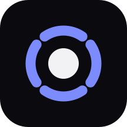

<p align="center">
  
</p>

<p align="center">
  <strong>android-tv-remote</strong><br>
  Your phone as the remote for an Android TV — or a TV box or projector that has no remote
  service at all. Nothing installed on either.
</p>

<p align="center">
  <a href="LICENSE"></a>
  <a href="../../actions/workflows/ci.yml"></a>
  
  
</p>

---

## What it is

Android TVs already listen for a remote on the local network — it is how the official Google TV
app works. This speaks that protocol, so **the TV needs no app, no sideloading and no setting
changed**. Pair once with a code shown on screen, and the phone is a remote from then on.

Plenty of cheaper devices — TV boxes, projectors — run a full Android TV image but ship *without*
that service, and no phone remote can reach them. This one can: it also speaks **ADB**, which
those devices do have. Same app, same screen; it picks the transport by what the device offers.

| Piece | What it does |
|---|---|
| [`protocol/`](protocol/) | The Android TV remote protocol v2, in plain Kotlin. **No Android dependency**, so it unit-tests on a desktop and ships a CLI that drives a real TV |
| [`app/`](app/) | The phone app — discovery, pairing, and the remote itself, in Compose |
| [`spike/`](spike/) | A Dart implementation of the same protocol, kept as a second reference |

```
phone                                   a TV with the remote service
┌────────────────────────┐             ┌──────────────────────────┐
│ mDNS browse            │ ──────────► │ _androidtvremote2._tcp   │
│                        │             │                          │
│ TLS :6467  pair once   │ ◄─────────► │ shows a 6-character code │
│ TLS :6466  key presses │ ──────────► │                          │
│            volume, app │ ◄────────── │ pushes its own state     │
└────────────────────────┘             └──────────────────────────┘

phone                                   a box or projector without it
┌────────────────────────┐             ┌──────────────────────────┐
│ mDNS browse            │ ──────────► │ _adb._tcp                │
│                        │             │                          │
│ ADB :5555  keys, text  │ ──────────► │ monkey's command port    │
│            volume, app │ ◄────────── │ polled, 2s               │
└────────────────────────┘             └──────────────────────────┘
```

A TV with the remote service talks back, which is the part that makes it feel connected rather
than hopeful: the volume bar moves when somebody uses the plastic remote, and the header shows
what is playing. Over ADB nothing is pushed, so that state is polled instead — and a volume press
re-reads it at once, so the bar still moves when you expect it to.

## Quick start

```bash
git clone git@github.com:amrakshay/android-tv-remote.git
cd android-tv-remote
./gradlew :app:assembleDebug
adb install -r app/build/outputs/apk/debug/app-debug.apk
```

Open the app with the TV **switched on**. It finds the TV, the TV shows six characters, you type
them in, and that is the last time you will see that screen.

See [docs/USAGE.md](docs/USAGE.md) for the SDK setup, a release build, and what to do when
discovery finds nothing.

## Devices without the TV Remote Service

Some devices advertise `_androidtvremote2._tcp` and some do not. An E-Gate projector
(`t950s_be311`, Android 13) has leanback, the Play Store, GMS and Katniss — and exactly one
listening socket, adbd on 5555. Sideloading the missing service does not help: it needs
`INJECT_EVENTS`, a `signature|privileged` permission, so a user-installed copy is inert.

**Turn on Wi-Fi debugging** in the device's developer options and it appears in the list marked
*over ADB*. There is no code to type; the device may ask once whether to trust this phone, and
ticking "always allow" is the end of it.

What changes on that transport:

| | Remote service | ADB |
|---|---|---|
| Pairing | 6-character code | the device's own "Allow debugging?" prompt |
| Key latency | a few ms | **~70 ms** through monkey's command port |
| Volume, foreground app | pushed by the TV | polled every 2 s, and right after a volume press |
| App list | not available — the deep links are guesses | **read off the device**, so every tile is real |
| Typing | only where the app reports a text field | **anywhere** — including YouTube's own keyboard |
| Focused field contents | reported by the TV | not available |

Typing is the interesting one. The remote protocol cannot reach apps that draw their own keyboard
into a `SurfaceView`, YouTube included, because no text field is ever announced. ADB injects real
key events, so it lands there too.

`input keyevent` would have been the obvious way to send keys and is far too slow — about 300 ms
per press on this hardware, because it is a shell script around `cmd`. monkey's command port keeps
a socket open and answers in about 70 ms, and its `key down` / `key up` map straight onto
press-and-hold. Everything that is not a key press still goes through an ordinary one-shot
`shell:` stream, where the 300 ms does not matter and the output is clean.

## Driving a TV without a phone

The protocol module is a plain JVM library, so it has a CLI. This is how the protocol was
developed and is still the quickest way to test a change:

```bash
./gradlew :protocol:tvcli --args="pair    192.168.0.236 creds"
./gradlew :protocol:tvcli --args="keys    192.168.0.236 creds VOLUME_DOWN VOLUME_UP HOME"
./gradlew :protocol:tvcli --args="search  192.168.0.236 creds the bear season 3"
./gradlew :protocol:tvcli --args="launch  192.168.0.236 creds https://www.youtube.com"
```

The same for a device on the ADB transport:

```bash
./gradlew :protocol:tvcli --args="adb-info   192.168.0.138 creds"
./gradlew :protocol:tvcli --args="adb-keys   192.168.0.138 creds DPAD_DOWN DPAD_UP"
./gradlew :protocol:tvcli --args="adb-text   192.168.0.138 creds the bear"
./gradlew :protocol:tvcli --args="adb-launch 192.168.0.138 creds org.videolan.vlc/.StartActivity"
```

## What works

Verified against a Xiaomi MiTV-AXSO0 from a OnePlus 7 — see
[docs/PLAN.md](docs/PLAN.md) for how each was checked.

- Discovery over mDNS, and a typed address for networks that block it
- Renaming a device, so a box called `t950s_be311` can be called what it is
- Pair once; the certificate is kept and reused
- D-pad and OK, Back, Home, Search
- Volume and mute, with the TV's own level shown live
- **Press and hold to repeat**, which the TV does itself rather than the phone spamming keys
- Media transport
- Typing into a text field on the TV
- Launching an app by deep link
- **Devices with no remote service, over ADB** — the same remote, plus a real app list and typing
  that reaches apps the TV protocol cannot

## What it deliberately does not do

- **It cannot switch the TV on.** This TV drops off the network entirely in standby — no ping, no
  ARP entry, every port closed — and Wake-on-LAN does not wake it. Your infrared remote works
  because the IR receiver is a separate always-on chip; there is no network equivalent. The app
  says so plainly rather than offering a button that silently fails. The measurements are in
  [docs/PLAN.md](docs/PLAN.md) §4.4.
- **No voice.** The protocol supports streaming the microphone; this does not.
- **No cloud, no account, no internet.** Everything is on your Wi-Fi.
- **iPhone is not supported.** The protocol is Kotlin, so that is a rewrite rather than a build
  step. Tracked as an issue.

## Typing does not work everywhere

**On the remote protocol**, typing lands in apps that use a standard Android text field. Some
apps — YouTube among them — draw their own keyboard into a `SurfaceView`, so no text field is ever
reported and nothing can be typed into them. The official Google TV remote cannot type into those
either. The keyboard sheet shows which case it is in instead of swallowing the difference.

**Over ADB** there is no such limit, because the key events are real ones: typing reaches YouTube's
search box. What it cannot do is replace what a field already holds — text arrives at the cursor —
so the sheet offers a backspace instead of a clear.

## Tested on

| | |
|---|---|
| TV | Xiaomi MiTV-AXSO0 (`dangal`, sold as Mi TV 4A Pro / 4C Pro), Android TV 9, firmware PI.6036 |
| Projector | E-Gate (`t950s_be311`, Amlogic, Android 13) — no remote service, driven over ADB |
| Phone | OnePlus 7 (GM1901), Android 10 |

Other Android TVs should work — the protocol is Google's, not Xiaomi's — but nothing else has
been tried.

## Documentation

| | |
|---|---|
| [docs/USAGE.md](docs/USAGE.md) | Building, installing, and what to do when it does not find the TV |
| [docs/PLAN.md](docs/PLAN.md) | The engineering record: the protocol in detail, what was measured, what is still untested |
| [CONTRIBUTING.md](CONTRIBUTING.md) | How to work on it |
| [SECURITY.md](SECURITY.md) | What the pairing certificate does and does not protect |

## Requirements

- **To build:** JDK 17+, the Android SDK (`platforms;android-37.2`, `build-tools;37.0.0`). No
  Android Studio required — the Gradle wrapper is checked in.
- **To run:** Android 8.0 (API 26) or newer, on the same Wi-Fi as the TV.
- **The TV:** any Android TV. Nothing is installed on it.
- **A device without the remote service:** Wi-Fi debugging on, in its developer options. Still
  nothing installed on it.

## Licence

[MIT](LICENSE).
